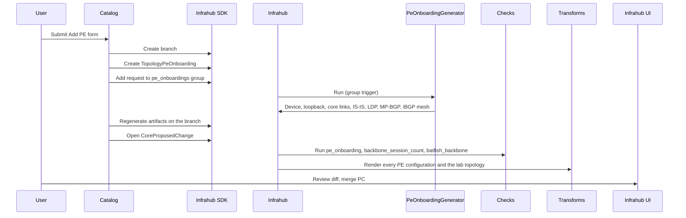

# Add a PE router

This page documents PE onboarding end-to-end: how an operator adds a PE
router to the MPLS backbone through the Streamlit catalog, what Infrahub does
automatically, which checks gate the merge, and how to boot the new router in
the lab afterwards.

For field-level schema details see [schema-reference](../schema-reference.mdx).

---

## User flow



### Step-by-step

1. **Catalog form**: the operator names the new router, picks its backbone,
   site, platform and device type, and selects at least two existing PEs as
   uplinks. The form rejects a name that already exists, fewer than two
   distinct uplinks, or an uplink outside the chosen backbone.
   Only platforms with a PE configuration artifact are offered: Arista EOS,
   Cisco IOS-XR, Juniper Junos and Nokia SR OS.

2. **Branch and request**: the catalog opens a branch named
   `backbone/add-pe-<name>-<id>` and writes one `TopologyPeOnboarding` row
   with `status = draft`.

3. **Generator run (event-driven)**: the catalog then adds the request to the
   `pe_onboardings` group. That membership change fires `trigger-pe-generator`
   (`objects/events/00_triggers.yml`), which runs `PeOnboardingGenerator`
   on the branch. Like `generate_l3vpn`, the generator is kept out of the
   proposed-change pipeline (`execute_in_proposed_change: false`), because in
   the pipeline it races artifact rendering and the proposed change shows no
   configuration diff.

4. **Proposed change**: once the generator has linked the device and written
   every core port and iBGP session, the catalog re-renders every artifact on
   the branch and opens a `CoreProposedChange` into `main`.
   If generation times out, the catalog stops and preserves the branch for
   inspection. It does not render artifacts or open a proposed change for an
   incomplete PE.

5. **Checks**: the validators listed under [Checks](#checks) must pass.

6. **Merge**: the operator reviews the diff and merges. The new router appears
   in the lab on the next `invoke lab.deploy`.

---

## Generator: what it creates

For a request with two uplinks on a backbone that already has N PEs, the
generator writes:

| Object | Count | Notes |
|---|---|---|
| `DcimDevice` | 1 | `role = pe`, backbone AS, request's platform, device type and site |
| `InterfaceVirtual` Loopback0 | 1 | Address allocated from `pe_loopback_pool` |
| `IpamPrefix` /31 | 2 | One per uplink, from `backbone_p2p_pool` |
| `InterfacePhysical` on the new PE | 2 | `Ethernet1`, `Ethernet2`, `role = core`, MTU 9000, in uplink name order |
| Spare `InterfacePhysical` on the new PE | 2 | `Ethernet3`, `Ethernet4`, `role = cust`, `status = free`, ready for L3VPN attachments or later backbone links |
| `InterfacePhysical` on each uplink PE | 1 each | The lowest `status = free` port, converted to `role = core` and described `To <new PE>` |
| `IpamIPAddress` | 1 + 4 | The loopback, then both ends of each /31 (new PE even, uplink odd) |
| `MplsIsisProcess`, `MplsLdpProcess`, `MplsBgpProcess` | 1 each | NET derived from the loopback, for example `10.0.0.9` becomes `49.0001.0100.0000.0009.00` |
| `RoutingBGPSession` | 2 x N | `<new> to <peer>` on the new PE and `<peer> to <new>` on every other PE |
| Group membership | `pes`, `pe_<platform>` | So the configuration artifact definitions target the new router |
| Backbone membership | 1 | The device joins `TopologyMplsBackbone.pes`, so the lab topology includes it |

The sessions are created on both ends because the PE templates render
`RoutingBGPSession(device__name__value: $device)`: an existing PE only gains
the new neighbour in its configuration when it holds its own session row.

Rerunning the generator preserves any service or backbone link that has since
claimed a spare port. It does not reset those ports to `free`.

No transform or template changes are needed. The containerlab transform
derives backbone links from the core ports that share a /31, and the artifact
definitions already target the groups the device joins.

---

## Checks

| Check | Target | What it rejects |
|---|---|---|
| `pe_onboarding` | `pe_onboardings` | Incomplete generation (status, linked device, backbone membership, core-port and iBGP-session counts), fewer than two distinct uplinks, the router as its own uplink, an uplink that is not a PE of the backbone, or an uplink with no free port left |
| `backbone_session_count` | `pes` | Any PE with fewer than N-1 iBGP sessions after the change, which is what a missing reverse session looks like |
| `batfish_backbone` | `topologies_mpls` | Configurations Batfish cannot parse, IS-IS adjacencies that do not form between the rendered configurations, or incompatible BGP sessions |

---

## After merge: boot the new PE in the lab

`invoke lab.deploy` tears the whole lab down and boots every node again:
containerlab has no way to add a node to a running lab. With nine PEs, allow
several minutes for EOS to come up, and expect any collector that reads the
lab by container address to re-discover everything.

```bash
uv run invoke lab.deploy
containerlab exec -t lab/mpls-backbone.clab.yml --label clab-node-name=pe-09 \
  --cmd "show bgp summary"
containerlab exec -t lab/mpls-backbone.clab.yml --label clab-node-name=pe-09 \
  --cmd "show isis neighbors"
```

Expected: every other PE listed as an established iBGP neighbour, and one
IS-IS adjacency per uplink.

---

## Known limitations

- **Changing a request's uplinks after generation is not supported.** The port
  the generator claimed on an uplink PE belongs to that PE, so the generator
  never un-claims it. Delete the request and open a new branch instead.
- **Management addresses are not pinned.** The containerlab topology lets
  containerlab assign management addresses, so adding a node can shift the
  address an external collector was configured with.
- **The iBGP mesh grows quadratically.** Nine PEs means 72 session rows. A
  route reflector model is the natural next step and is not part of this flow.

---

## Rolling out to an instance that already runs this repository

The repository sync delivers `.infrahub.yml` content only: the generator, the
check and the queries. Schema, menu and object files are loaded by
`invoke bootstrap`, so an instance that was bootstrapped before this feature
needs them loaded by hand after pulling the commit:

```bash
uv run infrahubctl schema load schemas/
uv run infrahubctl menu load menus/menu.yml
uv run infrahubctl object load objects/55_groups.yml
# Wait until the CoreRepository reports in-sync, so generate_pe exists.
uv run infrahubctl object load objects/events/00_triggers.yml
INFRAHUB_SERVICE_CATALOG=true uv run invoke start   # rebuilds the catalog container
```

All four loads are idempotent.

One more thing to check on an instance whose repository carries branches that
predate this change. The repository sync creates an Infrahub branch per git
branch and deletes the `pe_onboarding` check definition on every branch whose
`.infrahub.yml` does not declare it. Infrahub 1.11.7 then refuses to create
the `Check: pe_onboarding` validator on any branch, so the check is silently
missing from every proposed change (the task-worker log shows
`Unable to find the node <id> / CoreCheckDefinition`). Delete those stale
Infrahub branches, or bring the git branches up to date, and the check runs
again. The other validators are unaffected.
